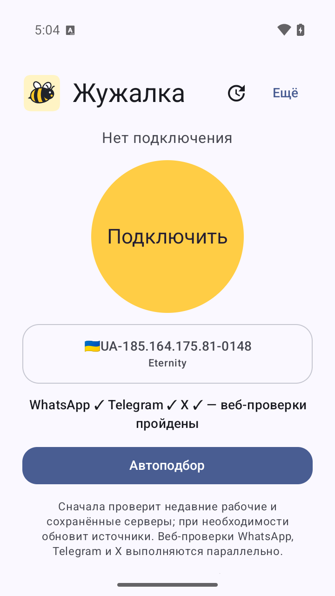
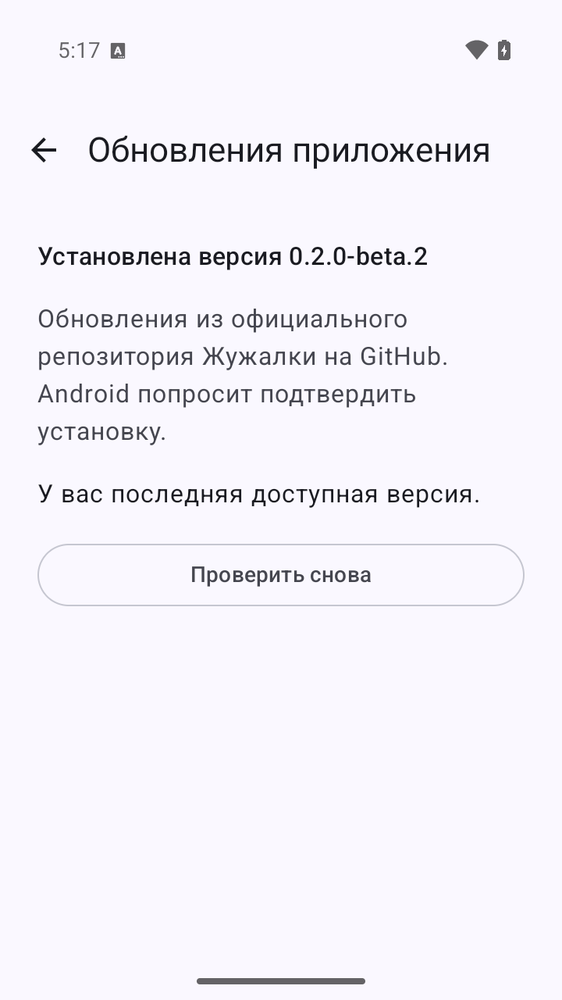

<div align="center">

# 🐝 Жужалка

**Простой VPN-клиент для Android. Для себя и друзей.**

Шесть бесплатных списков · свои подписки · автоподбор · сеть сообщества · обновления

[**Опубликованные APK для Android**](https://github.com/UserOfTheWorld-code/zhuzhalka/releases)
&nbsp; · &nbsp;
[Как пользоваться](#как-пользоваться)
&nbsp; · &nbsp;
[Исходники и сборка](#для-разработчиков)

Android 7.0+ · Kotlin / Compose · GPL-3.0 · готовится 0.3.0-alpha.1

</div>

<p align="center">
  
  &nbsp;
  
</p>

Здесь исходники **0.3.0-alpha.1**, `versionCode = 5000300`. Обе debug-сборки прошли по
374 модульных теста, обмен сообщества проверен между двумя независимыми установками на
одном Android 15 эмуляторе. Release APK собраны с постоянной подписью; свежая установка
F-Droid `x86_64` отдельно прошла проверку запуска. Alpha пока не опубликована.
Текущие результаты и незавершённые сценарии — в [отчёте alpha](docs/version-0.3-alpha.1-validation.md).
Оба скриншота относятся к **0.2.0-beta.2** и не показывают интерфейс сообщества.
Для прежней beta.2 обе сборки прошли по 267 модульных тестов, основные сценарии автоподбора
проверены на Android 15. Это исторические результаты, а не подтверждение новой alpha.
Замеры и ограничения сохранены в [отчёте beta.2](docs/version-0.2-beta.2-validation.md).
Сохранён и [отчёт предыдущей beta.1](docs/version-0.2-validation.md).
Для публикации alpha требуется настроить постоянный ключ подписи в GitHub Actions с разрешения владельца.
[Релиз 0.1](https://github.com/UserOfTheWorld-code/zhuzhalka/releases/tag/v0.1.0-beta.1) остаётся доступен.

## Установка

1. Откройте [список опубликованных релизов](https://github.com/UserOfTheWorld-code/zhuzhalka/releases).
   Пока доступен выпуск 0.1. После публикации alpha появится [страница v0.3.0-alpha.1](https://github.com/UserOfTheWorld-code/zhuzhalka/releases/tag/v0.3.0-alpha.1).
2. Для новой alpha скачайте **Zhuzhalka_0.3.0-alpha.1_universal.apk** — он подходит для всех поддерживаемых архитектур.
   Для большинства современных телефонов также подойдёт меньший `arm64-v8a.apk`.
3. Откройте APK на телефоне и разрешите установку из выбранного браузера или файлового менеджера.
4. Запустите «Жужалку». При первом подключении Android попросит разрешение на VPN.

Начиная с 0.2 пользовательские APK подписываются постоянным ключом. Последующие версии с тем же
сертификатом и большим кодом версии смогут устанавливаться поверх приложения с сохранением данных.
Установка бесплатна, регистрация не нужна. APK, полный архив исходников и контрольные суммы публикуются вместе.

**Переход с 0.1 выполняется один раз вручную:** экспортируйте нужные профили и ссылки подписок,
сохраните необходимые настройки, затем удалите 0.1, установите новый выпуск с постоянной подписью и импортируйте данные.
У 0.1 временная debug-подпись, несовместимая с новым ключом. Не удаляйте её до сохранения данных.
[Подробности подписи и перехода](docs/release-signing.md).

## Как пользоваться

- **Кнопка списка** загружает источник при первом нажатии, затем открывает сохранённые серверы.
- **Обновить** получает свежий список. У каждого источника и своей подписки есть отдельная кнопка.
- **Автоподбор** сначала заново проверяет недавние успешные серверы, затем сохранённые профили.
  Если подходящего нет, обновляет источники по очереди и проверяет каждый до загрузки следующего.
  При работающем VPN кнопка предлагает подтвердить отключение перед поиском.
- **Подключить / Отключить** управляет VPN. После автоподбора подключитесь к выбранному серверу.
- **Моя подписка** принимает HTTPS-ссылку совместимого V2Ray-провайдера.
- **Сеть Жужалки** включает добровольный обмен оценками и явно опубликованными списками.
  По умолчанию участие выключено; личные подписки автоматически не публикуются.
- **Обновления приложения** проверяет официальный GitHub-репозиторий, скачивает APK и проверяет
  контрольную сумму, пакет, версию и сертификат. Установку подтверждает пользователь в окне Android.
- **Ещё** открывает расширенные настройки v2rayNG.

Автоподбор параллельно проверяет HTTPS-доступ к `web.whatsapp.com`, `web.telegram.org` и `x.com`
через один профиль; для его выбора должны пройти все три проверки. Это проверка веб-доступа: она не доказывает работу сообщений,
входа и звонков. На устройстве сохраняется до пяти GUID успешных профилей и время проверки на срок до 24 часов,
без копий ключей подключения. При повторном поиске все три проверки выполняются заново;
при успехе списки повторно не скачиваются. Удалённые и неподходящие профили пропускаются.
В простом режиме нельзя запустить профиль с отключённой проверкой сертификата:
автоподбор пропустит его, а при ручном выборе появится объяснение. Проверка TLS не отключается ради подключения.

Бюджет поиска — 180 секунд, включая загрузки списков. Он и лимиты отдельных этапов ограничивают
начало новых операций, а не гарантируют время завершения. Уже начатые native-проверки могут закончиться
позже; отмена тоже ждёт их завершения. Скорость поиска зависит от сети и доступности серверов.
Если подходящий сервер не найден, обновите список или попробуйте другой источник.

Обновления скачиваются с GitHub напрямую. Если GitHub недоступен из текущей сети, проверка обновлений
может не сработать и при включённом VPN: собственный пакет приложения исключён из туннеля.
Проверки через Xray и запуск VPN-службы не доказывают работоспособность всех приложений через системный VPN.

## Экспериментальная сеть сообщества

В alpha устройства обмениваются подписанными данными через независимые публичные relay Nostr.
Собственный платный backend не требуется. Это короткие обмены в открытом приложении;
постоянная прямая связь между всеми телефонами и доставка в фоне не гарантируются.
После включения публикуются хеши серверов встроенных каталогов, результаты и время веб-проверок,
округлённая задержка и публичный ключ установки. Relay также видит IP-адрес.

Оценки действуют один час. По одному актуальному голосу от каждого ключа на сервер учитывается
при выборе порядка: нужны не менее двух ключей и большинство успешных проверок.
Вперёд перемещаются максимум три кандидата; недавние локальные успехи и выбранный сервер
сохраняют приоритет. Несколько ключей могут принадлежать одному человеку, поэтому рейтинг
не служит доказательством надёжности. Каждый кандидат всё равно проходит локальную проверку.

У своей подписки есть отдельное действие «Поделиться». Оно требует подтверждения, что **полный URL,
включая токен доступа, станет виден всем участникам и операторам relay**. Публикуйте только свою
подписку и только с разрешения провайдера. Полученную ссылку приложение показывает целиком
и загружает лишь после отдельного подтверждения. Отзыв своих предложений прекращает дальнейшее
распространение приложением, но не удаляет уже сохранённые чужие копии.

Внешний тест подтвердил бесплатную публикацию и чтение тестового события на двух relay.
Две debug-установки на одном эмуляторе обменялись публичным списком и реальной оценкой,
а получатель обработал отзыв списка после одного повторного запроса. Формат, ограничения и точные результаты —
в [описании сети сообщества](docs/community-network.md).

## Бесплатные источники

| Кнопка | Публикатор |
|---|---|
| Au1rxx | [Free VPN Subscriptions](https://github.com/Au1rxx/free-vpn-subscriptions) |
| Eternity | [V2RayAggregator](https://github.com/mahdibland/V2RayAggregator) |
| VPNBook | [Официальные Outline / Shadowsocks-конфигурации](https://www.vpnbook.com/freevpn/outline-vpn) |
| 0xRadikal · Top100 | [Free-v2ray-Configs](https://github.com/0xRadikal/Free-v2ray-Configs) |
| Matin · Super | [v2ray-configs](https://github.com/MatinGhanbari/v2ray-configs) |
| NodesRadar | [NodesRadar](https://github.com/nodesradar/nodesradar-en) |

В APK хранятся адреса источников. Конфигурации загружаются при обновлении;
дубли VPNBook, уже присутствующие в других загруженных списках, исключаются из его списка.
Подробности происхождения, лицензий и проверки — в [SOURCES.md](SOURCES.md).

Серверы принадлежат сторонним операторам. Их доступность, скорость и приватность
не гарантируются. У VPNBook есть журналы соединений. Приложение бесплатно;
стоимость собственной сторонней подписки определяет её провайдер.

## Для разработчиков

«Жужалка» — открытый форк [v2rayNG](https://github.com/2dust/v2rayNG) на Xray.
Новый интерфейс и операции разделены по существующим слоям проекта:

| Часть | Файл / каталог |
|---|---|
| Простой экран Compose | `ui/main/ZhuzhalkaScreen.kt` |
| Состояние и действия | `ui/main/MainViewModel.kt`, `ZhuzhalkaState.kt` |
| Каталог и импорт | `handler/PublicSourceCatalog.kt` |
| Официальный адаптер VPNBook | `handler/OfficialVpnBookSource.kt` |
| Веб-проверки через Xray | `core/ServiceWebProbe.kt` |
| Недавние успешные серверы | `handler/RecentSuccessfulServers.kt`, `ui/main/ZhuzhalkaAutoPicker.kt` |
| Обмен сообщества | `handler/CommunityRepository.kt`, `CommunityRelay.kt`, `CommunityProtocol.kt` |
| Ключи и подсказки рейтинга | `handler/CommunityIdentity.kt`, `CommunityRanking.kt` |
| Проверка и установка обновлений | `handler/ZhuzhalkaUpdateManager.kt`, `ui/checkupdate/` |
| Хранение | существующие `MmkvManager` и `SettingsManager` |

Пути в таблице относятся к `V2rayNG/app/src/main/java/com/v2ray/ang/`.
Детерминированная логика проверяется JUnit-тестами. Сетевые операции выполняются вне главного
потока, результаты сохранения читаются обратно, неудачное обновление сохраняет прежние профили.

```sh
git clone --recurse-submodules https://github.com/UserOfTheWorld-code/zhuzhalka.git
cd zhuzhalka
bash scripts/build-android.sh
```

Скрипт требует подготовленные JDK и Android SDK/NDK. Версии и подготовка окружения заданы
в [workflow](.github/workflows/build.yml). Он проверяет закреплённое native-ядро,
собирает HEV, запускает тесты и собирает обе debug-версии. Debug APK предназначены для разработки;
пользовательские обновления собираются отдельно с постоянной release-подписью.
Инструкции для Windows и детали — в [README.zhuzhalka.md](README.zhuzhalka.md),
[руководстве подписи](docs/release-signing.md) и [описании сообщества](docs/community-network.md).
Исторический [отчёт проверки beta.2](docs/version-0.2-beta.2-validation.md) относится только к той версии.

## Лицензия и благодарности

[GNU GPL v3](LICENSE). Сохраняйте лицензию и передавайте соответствующие исходники вместе с APK.
Спасибо авторам **v2rayNG**, **Xray**, **AndroidLibXrayLite** и **hev-socks5-tunnel**.
Это самостоятельная модифицированная сборка; она не является официальным релизом v2rayNG.
Исходное руководство сохранено в [README.upstream.md](README.upstream.md).
