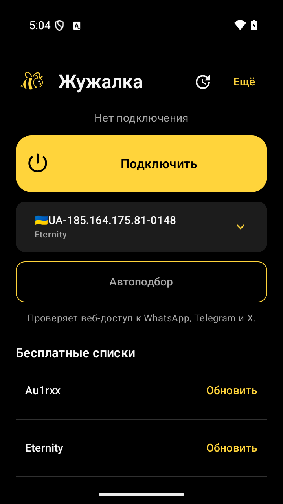

<div align="center">

# 🐝 Жужалка

**Простой бесплатный VPN-клиент для Android. Для себя и друзей.**

Чёрный фон · жёлтый акцент · пчела · отдельная кнопка для каждого списка

[**Скачать APK 0.3.0-alpha.4**](https://github.com/UserOfTheWorld-code/zhuzhalka/releases/tag/v0.3.0-alpha.4)
 · [Все выпуски](https://github.com/UserOfTheWorld-code/zhuzhalka/releases)
 · [Проверка версии](docs/version-0.3-alpha.4-validation.md)

Android 7.0+ · Kotlin / Compose · GPL-3.0

</div>

<p align="center"></p>

## Установка

На странице выпуска скачайте **Zhuzhalka_0.3.0-alpha.4_universal.apk**.
Для большинства современных телефонов также подходит меньший `arm64-v8a.apk`.
Откройте файл на телефоне, разрешите установку из выбранного браузера и запустите «Жужалку».
При первом подключении Android попросит разрешение на VPN. Регистрация не нужна.

**При переходе с 0.1 сначала сохраните данные.** У старого выпуска временная debug-подпись:
новый APK поверх него не установится. Экспортируйте профили и ссылки подписок, сохраните настройки,
удалите 0.1, установите новый выпуск и импортируйте данные. Новые выпуски подписываются постоянным
ключом и смогут обновляться поверх друг друга. [Подробнее](docs/release-signing.md).

## Возможности

- **Списки серверов:** шесть открытых источников и свои HTTPS-подписки. У каждого списка отдельная кнопка обновления.
- **Автоподбор:** недавние удачные подключения → сохранённые серверы → обновление списков по очереди. Общий рейтинг помогает выбрать порядок проверки.
- **Проверка соединения:** параллельный HTTPS-доступ к WhatsApp Web, Telegram Web и X. Для выбора сервера должны пройти все три проверки.
- **Обновления приложения:** поиск выпусков GitHub, скачивание APK, проверка суммы, пакета, версии и подписи. Установку подтверждает пользователь в системном окне Android.
- **Поделиться Жужалкой:** QR страницы скачивания, отправка ссылки или установленного APK через меню Android — Bluetooth / Quick Share (Wi-Fi), если их предлагает устройство.
- **Сеть Жужалки:** добровольный обмен оценками и опубликованными списками через несколько независимых relay Nostr. Собственный платный сервер не нужен.
- **Доступна всем:** при добавлении подписки можно разрешить распространение. После явного выбора объявление автоматически обновляется при синхронизации.

После автоподбора нажмите **«Подключить»**. При работающем VPN поиск предлагает сначала отключиться.
«Ещё» открывает расширенные настройки v2rayNG.

## Что изменено в alpha.4

Компактный главный экран: одна широкая кнопка подключения, простые строки списков, прежняя пчела.
Флажок `insecure` в чужом списке больше не означает автоматическое исключение из поиска.
Проверяется точная копия профиля с `insecure=false`, с сохранением SNI, pin, REALITY и ключей.
Только после трёх успешных проверок и сверки неизменности исходного профиля сохраняется строгий вариант.
Защита не отключается ради подключения. Pin и REALITY используют свои модели проверки подлинности;
успешный тест не доказывает добросовестность оператора сервера.

Обновление списков при автоподборе идёт напрямую, с ограничением времени и отменой запроса.
Поиск не ждёт загрузки всех источников перед первой попыткой. Общие оценки работают также для
явно опубликованных или принятых пользовательских списков; личные списки в рейтинг не уходят.

В открытом приложении синхронизация выполняется примерно раз в пять минут, когда нет другой операции.
Согласие на публикацию сохраняется между запусками и отзывается при изменении URL, отключении/удалении
подписки или добавлении приватных заголовков. Старые объявления alpha.1–3 не превращаются в бессрочное
согласие: нужно снова явно нажать «Поделиться».

## Обмен с друзьями

Откройте **«Поделиться Жужалкой»**. QR ведёт на GitHub, поэтому для скачивания нужен интернет.
**«Передать APK»** отправляет установленное приложение без подписок, настроек и личных ключей.
Способ передачи выбирается в меню Android; закрытие меню не подтверждает доставку.
При несовместимой архитектуре нужен universal APK; split-установки передаются ссылкой.

Включите **«Сеть Жужалки»**, чтобы обмениваться оценками. Переключатель **«Доступна всем в сети Жужалки»**
по умолчанию выключен. Его включение публикует **полный URL, включая токен доступа**, для участников
и операторов relay. Делитесь только своей подпиской, которую разрешено распространять.
Другие участники подтверждают загрузку полученного предложения. Принятие чужого списка разрешает
обновление и обмен оценками, но не повторную публикацию его URL от своего имени.

Устройства используют несколько relay, а не постоянные прямые соединения друг с другом.
Нет гарантированной фоновой доставки и полного охвата всех установок. Relay видят IP и публичный ключ.
Отключение обмена не удаляет уже скопированные другими данные. Оценки действуют час и никогда
не заменяют локальную проверку. [Протокол и ограничения](docs/community-network.md).

## Бесплатные источники

| Кнопка | Публикатор |
|---|---|
| Au1rxx | [Free VPN Subscriptions](https://github.com/Au1rxx/free-vpn-subscriptions) |
| Eternity | [V2RayAggregator](https://github.com/mahdibland/V2RayAggregator) |
| VPNBook | [Официальные Outline / Shadowsocks](https://www.vpnbook.com/freevpn/outline-vpn) |
| 0xRadikal · Top100 | [Free-v2ray-Configs](https://github.com/0xRadikal/Free-v2ray-Configs) |
| Matin · Super | [v2ray-configs](https://github.com/MatinGhanbari/v2ray-configs) |
| NodesRadar | [NodesRadar](https://github.com/nodesradar/nodesradar-en) |

В APK хранятся адреса источников; конфигурации скачиваются при обновлении. Дубли VPNBook исключаются.
[Происхождение источников](SOURCES.md). Серверы принадлежат сторонним операторам: доступность,
скорость и приватность не гарантируются. Клиент бесплатен; цену сторонней подписки определяет провайдер.

Проверка трёх сайтов подтверждает веб-доступ, не сообщения, вход или звонки. Бюджет поиска 180 секунд
ограничивает начало операций; начатые native-вызовы могут закончиться позже, отмена тоже ждёт их завершения.
Обновления GitHub скачиваются напрямую и могут быть недоступны в конкретной сети.
Результаты и непроверенные сценарии — в [отчёте alpha.4](docs/version-0.3-alpha.4-validation.md).

## Для разработчиков

Открытый форк [v2rayNG](https://github.com/2dust/v2rayNG) на Xray. Интерфейс находится в `ui/main/`,
импорт и сообщество — в `handler/`, проверки соединения — в `core/`.
Код Android расположен в `V2rayNG/app/src/main/java/com/v2ray/ang/`.

```sh
git clone --recurse-submodules https://github.com/UserOfTheWorld-code/zhuzhalka.git
cd zhuzhalka
bash scripts/build-android.sh
```

Версии инструментов закреплены в [workflow](.github/workflows/build.yml). Нужны JDK и Android SDK/NDK.
[Руководство проекта](README.zhuzhalka.md) · [Подписанные сборки](docs/release-signing.md) ·
[Исходное руководство](README.upstream.md). Исходники и контрольные суммы поставляются вместе с APK.
Закрытый ключ подписи в репозиторий не входит.

## Лицензия

[GNU GPL v3](LICENSE). Сохраняйте лицензию и передавайте соответствующие исходники вместе с APK.
Спасибо авторам v2rayNG, Xray, AndroidLibXrayLite и hev-socks5-tunnel.
Это самостоятельная модифицированная сборка, не официальный релиз v2rayNG.
