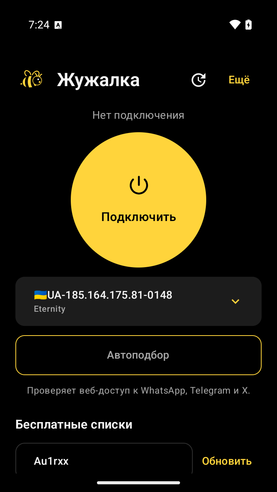
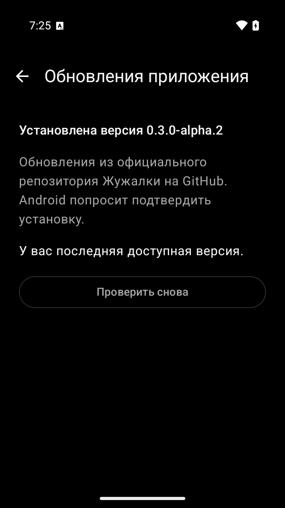
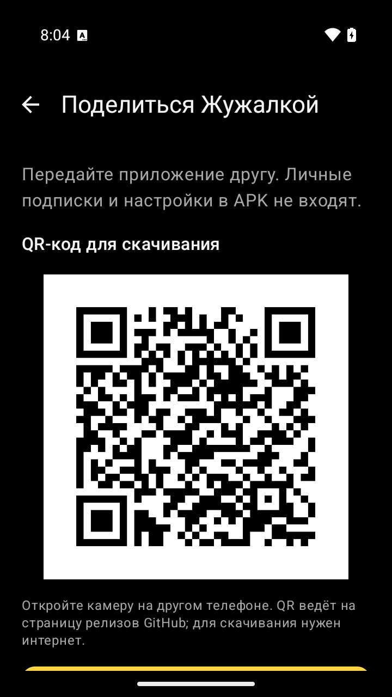
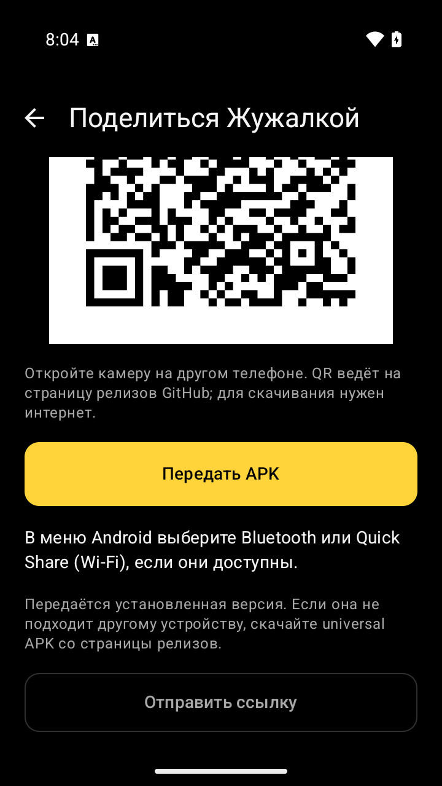

# Жужалка

Персональный VPN-клиент для Android, основанный на [v2rayNG](https://github.com/2dust/v2rayNG).
Приложение использует Xray, поддерживает публичные бесплатные каталоги и собственные подписки.
Имя пакета — `app.zhuzhalka.vpn`, версия — `0.3.0-alpha.4`, код — `5000303`.
Приложение устанавливается отдельно от v2rayNG. Иконка — векторная пчела.

В alpha.4 упрощён чёрно-жёлтый интерфейс, исправлен пропуск серверов по флажку insecure,
ускорено обновление каталогов при автоподборе, добавлено долговременное согласие на
распространение подписок и оценки принятых пользовательских списков. QR, передача APK,
Bluetooth / Quick Share через Android и обновления приложения сохранены.
[Скачать выпуск](https://github.com/UserOfTheWorld-code/zhuzhalka/releases/tag/v0.3.0-alpha.4).
[Результаты проверки alpha.4](docs/version-0.3-alpha.4-validation.md).

Исторические отчёты: [alpha.3](docs/version-0.3-alpha.3-validation.md),
[alpha.2](docs/version-0.3-alpha.2-validation.md), [alpha.1](docs/version-0.3-alpha.1-validation.md),
[beta.2](docs/version-0.2-beta.2-validation.md). Они не заменяют проверку нового APK.
Закрытый ключ подписи хранится локально и не нужен GitHub для загрузки готового APK.
Следующие изображения показывают прежний интерфейс; актуальный описан в основном README.

<p align="center">
  
  &nbsp;
  
</p>

Скриншоты `0.3.0-alpha.2` из debug APK на Android 15 / API 35, `x86_64`.

## Что бесплатно

Клиент и подключение публичных каталогов не требуют оплаты или аккаунта. Каталоги публикуют
сторонние операторы: они могут отключить сервер, изменить лимиты или удалить подписку.
Бесплатный клиент не означает собственную бесплатную серверную инфраструктуру.
Проверенные адреса каталогов и происхождение исходников описаны в [SOURCES.md](SOURCES.md).

Для отдельного списка серверов других VPN найден официальный бесплатный источник VPNBook.
Он публикует совместимые Outline/Shadowsocks-ключи. При добавлении сравниваются настройки
подключения, чтобы сервер из уже загруженного каталога не попадал в новый список второй раз.
На проверенном снимке из трёх серверов VPNBook два уже присутствовали в обоих каталогах;
новым был канадский сервер. Ключи обновляются с официальной страницы, а не сохраняются в APK.
VPNBook разрешает личное использование и хранит IP и время соединения до удаления журналов
раз в неделю; это не сервис без журналирования.

Собственная подписка добавляется по URL, полученному у вашего провайдера. Она должна возвращать
совместимый список конфигураций, например VLESS, VMess, Trojan или Shadowsocks. Обычная страница
личного кабинета и произвольная подписка другого VPN-приложения могут не подойти.
Цена сторонней подписки определяется её владельцем.

## Пользовательский сценарий

1. Нажмите кнопку источника, чтобы загрузить его впервые или открыть сохранённый список.
   Отдельная кнопка «Обновить» загружает свежие профили; она доступна и при подключении.
2. Выберите сервер вручную либо нажмите «Автоподбор». При работающем VPN приложение предложит
   подтвердить его отключение перед поиском. После выбора нового сервера подключитесь снова.
3. После выбора нажмите «Подключить» и разрешите VPN в системном окне Android.
4. Кнопка «Моя подписка» добавляет HTTPS-ссылку вашего провайдера. У сохранённой подписки
   также есть отдельная кнопка обновления.
5. «Обновления приложения» открывает проверку новых выпусков, скачивание и системную установку APK.
6. «Сеть Жужалки» открывает добровольный обмен оценками и предложениями списков. Участие по
   умолчанию выключено; подписка публикуется по явному выбору «Доступна всем» при добавлении
   или через отдельное действие «Поделиться».
7. «Поделиться Жужалкой» внизу главного экрана открывает QR-код, отправку ссылки и установленного APK.

Автоподбор сначала повторно проверяет недавние успешные профили, начиная с самого свежего.
Хранятся только GUID и время успешной проверки: максимум пять записей, срок хранения — 24 часа.
Перед каждой попыткой профиль заново разрешается по GUID; удалённые, исключённые из списка,
отключённые и неподдерживаемые профили не используются. Старый успех сам по себе не считается
подтверждением: снова должны пройти все три веб-проверки.

После недавних успешных серверов проверяются уже сохранённые профили: выбранный сервер имеет
приоритет, остальные чередуются между списками. Если подходящий найден на этих этапах,
каталоги не скачиваются. Иначе источники обновляются по одному, и после каждого обновления
проверяются его кандидаты до перехода к следующему источнику. При оставшемся бюджете поиск
возвращается к отложенным профилям, чередуя списки. Одинаковые параметры подключения повторно
не проверяются в пределах одного поиска, даже если такой профиль пришёл из другого источника.
Выбирается первый прошедший проверки сервер; поиск самого быстрого не выполняется.

Для одного профиля три HTTPS-проверки запускаются параллельно. Одновременно выполняется не более
трёх native-вызовов автоподбора в UI-процессе; следующий профиль ждёт завершения текущего.
Все три адреса должны пройти проверку. Общий бюджет поиска — 180 секунд, включая загрузки списков.
Отдельные этапы имеют лимиты попыток и времени: эти лимиты и общий дедлайн ограничивают начало
новых операций, а не прерывают уже начатый native-вызов. Поэтому операция может закончиться позже.
Отмена также ждёт завершения начатых JNI-вызовов: используемая AAR не предоставляет их прерывание,
а каждый выполняет до двух HTTP-попыток по 12 секунд, не считая создания и закрытия ядра.
Фиксированное время поиска не обещается. Это поиск по запросу пользователя; после выбора нового
профиля пользователь самостоятельно включает VPN.

Автоподбор и первичная загрузка источника выбирают совместимый профиль. Простая кнопка «Подключить»
повторно проверяет профиль перед запуском VPN, в том числе после возврата из системного запроса разрешения.
Профиль с `insecure=true` проверяется автоподбором как точная копия с `insecure=false`.
Только после трёх успешных проверок и сверки исходника строгий вариант сохраняется.
При ручном запуске неподтверждённого профиля показывается объяснение. Проверка TLS не отключается,
недоверенный сертификат автоматически не закрепляется. Прохождение этой предварительной проверки
означает допустимый тип профиля и настройки, но не гарантирует доступность сервера: её проверяют
HTTPS-запросы. Произвольный JSON, группы маршрутизации и неподдерживаемые типы в простой автоподбор не входят.

Проверки адресов WhatsApp, Telegram и X предназначены для проверки HTTPS-доступа через
проверяемый сервер. Успешная загрузка веб-адреса не доказывает работу входа, отправки сообщений,
видеозвонков, UDP или всех функций приложения. Конкретные ограничения и результат проверки
должны оставаться видимыми пользователю.

Операторы публичных серверов сторонние и неизвестны приложению. Используйте HTTPS и собственную
доверенную подписку для чувствительного трафика. Персональные ссылки могут содержать токены
доступа; их можно раскрывать только осознанно и с разрешения владельца сервиса.
Автоматическое резервное копирование Android отключено
в манифесте; экспорт и передача конфигураций остаются отдельными действиями пользователя.

## Передача приложения

<p align="center">
  
  &nbsp;
  
</p>

Один экран передачи приложения `0.3.0-alpha.3`: сверху и после прокрутки.
Android 15 / API 35, `x86_64`; ниже QR доступны действия отправки APK и ссылки.

«Поделиться Жужалкой» открывает отдельный экран. QR-код создаётся локально и содержит
только `https://github.com/UserOfTheWorld-code/zhuzhalka/releases`. Для скачивания по нему
нужен интернет. Установленную версию можно передать
как APK, но QR не гарантирует её наличие на странице релизов.
«Отправить ссылку» отправляет этот же адрес через системное меню Android.

«Передать APK» копирует установленный APK вне главного потока. Подписки, профили, ключи
сообщества и настройки не читаются и не добавляются. Используется версия и архитектура
установленного приложения; получателю с другой архитектурой предлагается universal APK
со страницы релизов. Split-установка отклоняется, чтобы не передать неполный base APK.

Копирование поддерживает отмену; незавершённый файл удаляется. Готовая копия остаётся
в отдельном каталоге кеша `shared-apks/`, чтобы получатель мог читать её после закрытия
меню. При следующих подготовках убираются собственные копии старше 48 часов; это не
гарантия точного срока хранения, поскольку Android также может очищать кеш.
Отдельный FileProvider `${applicationId}.share` открывает только этот каталог, получатель
получает временное разрешение на чтение URI. Его сроком управляет Android; закрытие
меню не гарантирует немедленный отзыв доступа. Новые разрешения Android не добавлены.

Системное меню предлагает доступные на устройстве приложения, например Bluetooth или
Quick Share (Wi-Fi). Жужалка не реализует собственный транспорт передачи файла и не
объявляет файл доставленным при возврате из меню. Используются стандартные механизмы
[Android Sharesheet](https://developer.android.com/training/sharing/send);
доступность и действия Quick Share описаны в [справке Android](https://support.google.com/android/answer/9286773).
Передавайте также соответствующие исходники и уведомления о лицензиях этой сборки.

## Экспериментальный обмен сообщества

В `0.3.0-alpha.1` добавлен обмен через независимые публичные relay Nostr. Нет единственного
сервера рейтингов Жужалки и необходимости оплачивать собственный backend. Обмен выполняется
короткими операциями в открытом приложении; постоянная связь всех установленных устройств,
хранение у посредников и фоновая доставка не гарантируются.

При включении участия создаётся случайный ключ установки. Закрытый ключ защищён AES-GCM
с ключом AndroidKeyStore, зашифрованная запись хранится через MMKV. Публично передаются
хеш идентификатора сервера из встроенного или явно опубликованного/принятого списка, результат и время веб-проверки,
округлённая задержка и публичный ключ. Relay видит IP соединения. Пароли профилей и
персональные подписки автоматически не экспортируются. Хеш публичного сервера не гарантирует
анонимности, а подпись не подтверждает, что за разными ключами стоят разные люди.

Для ранжирования действуют оценки не старше часа: одна последняя оценка от ключа на сервер,
не менее двух ключей и большинство успешных проверок. Максимум три кандидата могут подняться
в очереди; недавние локальные успехи и выбранный профиль остаются в приоритете. Временные метки
проверяются, просроченные и будущие события не принимаются. Чужой рейтинг не отменяет
проверки совместимости, TLS или всех трёх HTTPS-адресов на текущем устройстве.

Кнопка «Поделиться» у собственной подписки требует отдельного подтверждения публикации
**всего URL вместе с токеном доступа для всех участников и операторов relay**. Делитесь только
своим источником и только если провайдер разрешает публичное распространение. Полученные
предложения не загружаются автоматически: пользователь видит полный адрес и явно подтверждает
загрузку. «Перестать делиться списками» убирает свои предложения из последующих обменов,
но не отзывает копии, сохранённые другими участниками. Это публичный обмен; закрытые группы
друзей и зашифрованная передача подписок не реализованы.

Описание протокола, зависимости, ограничения и проверка реальной публикации/чтения на
`nos.lol` и `relay.primal.net` — в [docs/community-network.md](docs/community-network.md).
В alpha.1 отдельно на двух debug-установках одного эмулятора проверены публикация и явная загрузка
публичного списка, передача реальной оценки, отзыв предложения с одним повтором и сохранение
отказа от участия после перезапуска. Это не испытание двух физических телефонов.

## Обновления и переход с 0.1

Канал обновлений — [официальные релизы Жужалки](https://github.com/UserOfTheWorld-code/zhuzhalka/releases).
APK и исходники новой версии — в
[v0.3.0-alpha.4](https://github.com/UserOfTheWorld-code/zhuzhalka/releases/tag/v0.3.0-alpha.4).
Обновляющий компонент поддерживает пользовательский пакет `app.zhuzhalka.vpn`; отдельная
F-Droid-сборка не устанавливает APK этого канала поверх себя.

Перед предложением установки проверяются контрольная сумма, имя пакета, больший `versionCode`
и совпадение сертификата с установленным приложением. Проверка повторяется непосредственно
перед открытием системного установщика. Android отдельно запрашивает разрешение на установку
из этого приложения и подтверждение самого обновления. Автоматической установки нет.

Запросы к GitHub выполняются напрямую, без передачи через встроенный SOCKS/HTTP-прокси.
Собственный пакет Жужалки исключён из системного VPN, поэтому включённый VPN не гарантирует
доступ обновляющего компонента к GitHub. При недоступности GitHub требуется другая доступная
сеть или ручное скачивание официального APK. Это ограничение получения обновлений, а не
положительный или отрицательный результат проверки остальных приложений через VPN.

Версия 0.1 опубликована с временным debug-ключом CI. Он несовместим с постоянной подписью 0.2:
сначала экспортируйте профили и ссылки подписок, сохраните нужные настройки, затем удалите 0.1,
установите новый выпуск с постоянной подписью и восстановите данные. Удаление приложения стирает его локальные данные.
Этот переход нужен один раз; дальнейшие APK с тем же постоянным сертификатом и большим кодом
версии устанавливаются поверх приложения. Ключ нельзя менять между выпусками.
Инструкции сборки, резервного копирования ключа и настройки CI — в
[docs/release-signing.md](docs/release-signing.md).

## Сборка из исходников

Базовая ревизия v2rayNG: `aa4b05503a504a3f2e43818e6ee8ebf1caaa3df0` (2.3.14).
Исходное руководство проекта сохранено в [README.upstream.md](README.upstream.md).

Для Git checkout на Linux подготовьте SDK и выполните `bash scripts/build-android.sh`.
Скрипт проверяет ревизии подмодулей и SHA-256 AAR, собирает HEV, выполняет тесты и собирает APK.
Обычные push/PR в GitHub Actions используют тот же скрипт для debug-сборок. Они предназначены
для разработки и не подходят для обновления пользовательской release-установки.
Публикуемые APK 0.3 собираются как `release` с постоянным ключом и проверкой его публичного
отпечатка. Подписанная локальная сборка запускается через `scripts/build-signed-release.ps1`;
секреты и порядок настройки CI описаны в руководстве подписи.

Полный архив исходников включает подмодули и готовые native-входы `V2rayNG/app/libs`.
Архив выпуска называется `Zhuzhalka_0.3.0-alpha.4_sources.zip`.
Для такого архива шаги 1 и 3 ниже не требуются:
задайте SDK и запускайте Gradle напрямую. Встроенный архив GitHub «Source code» не включает
содержимое подмодулей, поэтому используйте полный архив или `git clone --recurse-submodules`.

1. Инициализируйте подмодули: `git submodule update --init --recursive`.
2. Подготовьте JDK, Android SDK и NDK согласно [сборочному workflow](.github/workflows/build.yml).
   Точные версии Gradle и зависимостей находятся в `V2rayNG/gradle/` и
   `V2rayNG/app/build.gradle.kts`.
3. Подготовьте HEV через `compile-hevtun.sh` и `libv2ray.aar` из ревизии
   `AndroidLibXrayLite`, закреплённой в gitlink. Следуйте шагам `scripts/build-android.sh`;
   произвольная старая AAR не является проверенной заменой.
4. Укажите расположение Android SDK в локальном `V2rayNG/local.properties`.
5. Из `V2rayNG` запустите в PowerShell:

```powershell
.\gradlew.bat :app:assemblePlaystoreDebug
```

APK находится в `V2rayNG/app/build/outputs/apk/playstore/debug/` и называется
`Zhuzhalka_0.3.0-alpha.4_<ABI>.apk`. `universal` подходит для нескольких архитектур;
`arm64-v8a` — для большинства современных Android-телефонов. Для выпуска обновлений
нужно сохранять один и тот же ключ подписи и увеличивать версию. Debug-подпись предназначена
для разработки и личной проверки.

Модифицированные ярлыки учитывают также пакет F-Droid `app.zhuzhalka.vpn.fdroid`.
Код Kotlin сохраняет исходное пространство имён `com.v2ray.ang`; оно отличается от
идентификатора установленного приложения. В 0.3.0-alpha.4 используется единый `versionCode = 5000303`
для всех ABI и дистрибуций; ABI-зависимые переопределения удалены. Следующий выпуск обязан
увеличить код, чтобы arm64 и universal могли обновлять друг друга.

### Публикация alpha через GitHub Actions

Основной путь — **Publish verified local APKs**. APK собираются и подписываются локально;
Actions проверяет и публикует готовые файлы. Приватный ключ и пароль остаются на компьютере,
Actions Secrets для этого пути не нужны.

1. Завершите проверки и сохраните исходники в `master`. Упакуйте подписанные APK и полный
   исходный архив командой `python scripts/package-release.py --output release-dist` из чистого
   checkout этого коммита, с настроенными JDK/Android SDK.
2. На основе дерева коммита исходников подготовьте отдельный Git tree, добавив `manifest.json`
   и части `chunks/00-0000.bin`, `chunks/01-0000.bin` и далее. Исходные файлы не меняйте.
   Размер части — 4 МиБ, последняя может быть меньше.
   Порядок файлов, поля манифеста и проверки описаны в [руководстве](docs/release-signing.md#github-actions).
   После создания коммита bundle создайте ветку `release-bundle/alpha4-<bundle_commit>` на его точном SHA.
3. Подготовьте draft релиза `v0.3.0-alpha.4`. Откройте **Actions → Publish verified local APKs →
   Run workflow**, выберите **master** и передайте полный 40-символьный SHA в `bundle_commit`.
   `source_commit` манифеста и `BUILD_INFO.json` должны совпадать с коммитом `master` этого запуска.
4. Workflow сверяет размеры и SHA-256 частей/файлов, подпись, пакет, версию и отсутствие
   `debuggable` в APK. Публикатор повторно скачивает загруженные файлы, затем открывает
   prerelease с `latest=false`. После успеха удаляется только временная ветка bundle,
   всё ещё указывающая на переданный SHA; при ошибке публикации она сохраняется для повтора.

В релиз входят `Zhuzhalka_0.3.0-alpha.4_arm64-v8a.apk`, `Zhuzhalka_0.3.0-alpha.4_universal.apk`,
`Zhuzhalka_0.3.0-alpha.4_sources.zip` и `SHA256SUMS`. Исходный ZIP включает рекурсивные подмодули
и использованные AAR/HEV-библиотеки. Шаг публикации использует автоматический `GITHUB_TOKEN`.
Этот workflow не повторяет локальную сборку, модульные тесты или Android QA.

Дополнительный вариант — **Build Android APKs**, ручной запуск с `master` и
`publish_release=true`: он собирает и подписывает APK в облаке и требует отдельной настройки
постоянного ключа в Actions Secrets по [руководству подписи](docs/release-signing.md#github-actions).
Обычные push/PR выполняют debug-сборку без публикации и доступа к ключу.

Это инструкция процесса, а не подтверждение завершённой публикации alpha.4.
Локальные результаты и ограничения фиксируются в [отчёте alpha.4](docs/version-0.3-alpha.4-validation.md).

## Подтверждения предыдущей версии 0.1

Первый выпуск опубликован [успешным запуском GitHub Actions](https://github.com/UserOfTheWorld-code/zhuzhalka/actions/runs/41075710433)
из коммита `ce71ae295a23a74b2ad226bbd5c6c49398fcf978`: 172 теста прошли без ошибок и пропусков,
обе сборки завершены, подписи APK и повторно скачанные файлы релиза проверены.
В этом выпуске CI использовал временный debug-ключ. Локальная проверка на эмуляторе,
описанная ниже, не является отдельной проверкой опубликованных CI-APK 0.1.

### Локальная проверка 0.1

Подтверждена загрузка файлов публичных подписок по HTTPS и прочтение их формата; это не проверка
VPN-соединения с каждым узлом. Подробности и время снимка — в `SOURCES.md`.

На сборке от 30 октября 2026 прошли все **172 unit-теста** без ошибок и пропусков
(`:app:testPlaystoreDebugUnitTest`), компиляция `:app:compilePlaystoreDebugKotlin`
и сборка APK обоих вариантов: `:app:assemblePlaystoreDebug`, `:app:assembleFdroidDebug`.
Workflow проверен `actionlint`, сборочный Bash-скрипт — синтаксической проверкой.

На эмуляторе Android 35 приложение установлено и запущено с русским интерфейсом.
Проверен импорт всех шести источников: Au1rxx — 1 751, Eternity — 199, VPNBook — один новый профиль
после удаления совпадений, Top100 — 100, Matin — 200, NodesRadar — 494 принятых профиля.
Загрузка нового списка переключает видимую группу и включает кнопку подключения.
Проверены работа диалога собственной подписки с экранной клавиатурой и отмена автоподбора.
Полный автоподбор выбрал профиль Eternity, прошедший все три HTTPS-проверки:
`web.whatsapp.com`, `web.telegram.org` и `x.com`. Эти запросы выполнялись через проверяемый
профиль Xray, до включения системного VPN.
Системное разрешение VPN получено; подключение запускает `CoreVpnService` как foreground
service, отключение останавливает службу. HTTPS-запрос приложения Android через установленный
системный VPN-туннель отдельно пока не подтверждён.

Not run / ещё не завершено на момент подготовки этой записи:

- HTTPS через VPN-туннель, реальные сообщения и звонки WhatsApp/Telegram/X,
  доступность всех публичных серверов — таких подтверждённых результатов пока нет.
- Сценарии на физическом Android-телефоне — использовался только эмулятор.
- Запуск APK, собранных в GitHub Actions, на эмуляторе или физическом телефоне — отдельно не выполнялся.

Результаты относятся к описанным сценариям и снимкам каталогов. Сборка APK и запуск службы
сами по себе не подтверждают доступ к сервисам из сети пользователя.

## Исходники и лицензии

v2rayNG распространяется по GNU GPL v3; текст [LICENSE](LICENSE) сохранён.
При передаче модифицированного APK передавайте соответствующие исходники этой сборки,
инструкции сборки и уведомления о лицензиях. Не представляйте сборку как официальный релиз
v2rayNG и не используйте подпись upstream как подпись «Жужалки».

Лицензии native-компонентов и ссылки на исходные ревизии перечислены в `SOURCES.md`.
Ссылки публичных каталогов являются внешними источниками; приложение не владеет их серверами.
