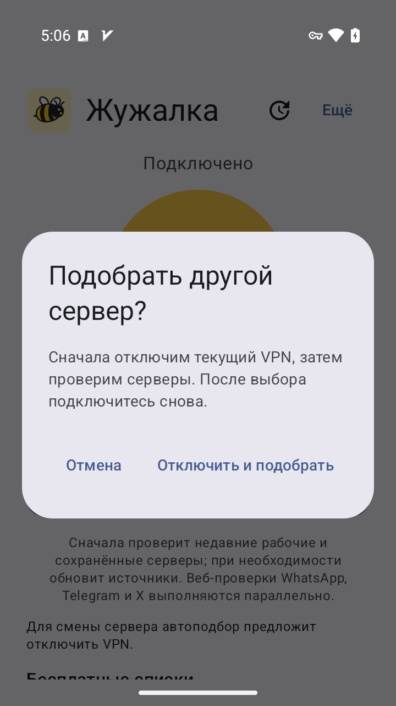

# Проверка Жужалки 0.2.0-beta.2

Версия `0.2.0-beta.2`, код `5000201`. Этот отчёт относится к исправлению автоподбора.
Результаты предыдущей сборки находятся в [отдельном отчёте](version-0.2-validation.md).

## Что воспроизведено до исправления

На Android 15 / API 35, `x86_64`, эмуляторе `zhuzhalka-test` проверена установленная
`0.2.0-beta.1` / `5000200`. Контрольная сумма debug APK:
`04056dce393dffb4ac08f3309c9c3e8458be0e7b539c3e02bfbdcf375d03607f`.

- После обычного обновления каталога, заменившего GUID недавнего профиля, поиск занял
  **97,24 с** до наблюдаемого успеха. Первые **25–30 с** заняли каталоги до начала проб.
- Следующий поиск с сохранённым успешным профилем занял **8,89 с**.
- При включённом VPN кнопка автоподбора была отключена.
- У существующего профиля с `insecure=true` без закреплённого сертификата сначала
  появлялось неточное сообщение о незашифрованном соединении, затем ядро отказывалось
  запускаться с ошибкой об удалённой настройке `allowInsecure`.

Время измерено от команды нажатия до первого снимка UI с результатом. Это верхние
оценки с погрешностью опроса интерфейса, не точный native benchmark. Доступность
публичных серверов меняется; один прогон не доказывает постоянное ускорение.

## Изменения

- Поиск начинает с недавних успешных и уже сохранённых профилей. При необходимости
  обновляет источники по одному, проверяя кандидатов после каждого обновления.
- Профили разных каталогов с одинаковыми параметрами подключения не проверяются
  повторно в одном поиске. Ключи сравнения существуют только в памяти.
- WhatsApp Web, Telegram Web и X проверяются параллельно. Успех требует всех трёх
  результатов; общий предел — три одновременно выполняющихся native-вызова.
- Неподдерживаемые профили с отключённой проверкой сертификата пропускаются. Ручной
  запуск из простого режима проверяет профиль до системного разрешения и после него.
  Проверка сертификатов не отключается автоматически.
- При работающем VPN автоподбор предлагает подтверждённое отключение. Он ждёт
  результата команды от службы и проверяет маршрут своего процесса через Android.
  `STOP_SUCCESS` не трактуется как завершение освобождения всех ресурсов службы.
  Собственный пакет исключён из TUN, а проверочные ядра работают в UI-процессе.
- Общий бюджет допуска новых операций — 180 секунд, включая загрузку каталогов.
  Фазовые лимиты ограничивают начало новых кандидатов. Уже начатые blocking HTTP/JNI
  могут закончиться позже; отмена ждёт их завершения и не запускает второй поиск поверх.

## Сборка и проверка исправления

| Проверка | Результат |
|---|---|
| Целевые JVM-тесты Playstore после последней правки | PASS — 61 тест: `ServiceWebProbeTest` 9, `ZhuzhalkaAutoPickerTest` 28, `ZhuzhalkaConnectionTest` 16, `ZhuzhalkaSelectionTest` 8. Ошибок и пропусков нет; 37 с |
| `:app:testPlaystoreDebugUnitTest`, `:app:testFdroidDebugUnitTest` | PASS — по 267 тестов в каждом варианте; 0 failures, errors, skipped |
| Компиляция Kotlin, debug/release APK, lint обоих вариантов | PASS — `compilePlaystoreDebugKotlin`, `compileFdroidDebugKotlin`, `assemblePlaystoreDebug`, `assembleFdroidDebug`, `assemblePlaystoreRelease`, `assembleFdroidRelease`, `lintPlaystoreDebug`, `lintFdroidDebug`; общий прогон с unit-тестами — 8 мин 6 с |
| Lint | 0 ошибок; Playstore — 338 warnings и 1 hint, F-Droid — 354 warnings и 1 hint. Сборка не объявляется свободной от предупреждений |
| Подпись и состав release APK | PASS — все 10 APK: постоянный сертификат, подпись v2, ожидаемые package/version/code, `debuggable=false`; `libgojni.so`, `libhev-socks5-tunnel.so`, `libhevsockstun.so` для каждой заявленной ABI |
| Синтаксис workflow / скриптов | PASS — actionlint 1.7.12, `sh -n` обоих Bash-скриптов, Python `py_compile` упаковщика |
| Изолированные сценарии упаковки и публикации | PASS — рекурсивные подмодули и лицензии, 9 native-входов, отсутствие машинных файлов, отказ при изменённых исходниках, неверной версии/debug-подписи, чужом теге, лишнем asset, повреждённом скачивании и неверной контрольной сумме. Вызовы GitHub в этих сценариях подменены тестовыми, публикации не было |

## Повторные замеры на Android

На том же Android 15 / API 35, `x86_64` установлен debug APK beta.2 с сохранением
данных приложения: 42 050 143 байта, SHA-256
`7182dcc79e368ec295fd66cae6f0e4fc0b3af508b889200f8cd66d01192e19e2`.
Во время измерений Gradle и Kotlin compiler не работали.

| Сценарий | beta.1 | beta.2 |
|---|---:|---:|
| Первый поиск по недавнему профилю после запуска | 15,33 с | 9,44 с |
| Поиск после обычного обновления каталога, заменившего GUID недавнего профиля | 97,24 с | 8,60 с |
| Начало проверок в этом поиске | примерно 25–30 с | уже на снимке 4,43 с |
| Немедленный повтор после найденного сервера | 8,89 с | 3,96 с |

Во втором сценарии beta.2 показала «Проверка сервера 1 из 12»: это сохранённые
кандидаты, а не недавний кэш. Загрузка каталогов внутри этого поиска не потребовалась.
Во всех успешных поисках прошли все три HTTPS-проверки.

Это верхние оценки по UI-снимкам, единичные прогоны, не статистический benchmark.
Для сброса актуального кэша beta.1 обновляла Au1rxx, beta.2 — Eternity, содержащий
выбранный недавний профиль. Каталоги и доступность серверов менялись; эти числа не
доказывают фиксированный коэффициент ускорения или качество всех публичных серверов.
Наблюдение подтверждает устранение обязательной загрузки всех источников до первых проб.

## Проверки поведения на Android

| Сценарий | Результат |
|---|---|
| Ручной запуск прежнего TROJAN/ws/tls-профиля с `insecure=true` | PASS — понятное встроенное объяснение, без процесса VPN-службы и без новой raw-ошибки `allowInsecure` в журнале приложения |
| Автоподбор после такого отказа | PASS — кнопка доступна, выбран другой профиль, все три проверки пройдены; наблюдаемый успех через 3,98 с |
| Автоподбор при работающем VPN | PASS — кнопка активна, открывается подтверждение; Cancel сохраняет VPN |
| Подтверждение «Отключить и подобрать» | PASS — служба VPN остановлена, поиск завершён с тремя успешными проверками; автоматического переподключения нет. Кэшированный процесс `:daemon` сам по себе не считается работающим VPN |
| Поворот экрана с открытым диалогом | PASS — подтверждено пересоздание MainActivity, диалог восстановлен |
| Клавиатура и D-pad | PASS — Enter/Space и D-pad открывают диалог и выполняют его действия; подтверждение через D-pad завершило реальный поиск |
| Системное разрешение VPN | PASS — после Forget VPN только для Жужалки Cancel оставил данные и профиль, без службы VPN; повторный Connect снова запросил разрешение |
| Пересоздание Activity во время системного запроса | PASS — событие relaunch MainActivity подтверждено; после OK запущена foreground-служба VPN с тем же профилем |
| Отмена поиска и повтор | PASS — отмена наблюдалась в стадии загрузки каталога; спустя примерно 10 с поздний успех не появился. Повторный поиск нашёл сервер |
| Отмена во время проверки профиля | PASS — снимок показывает «Проверка сервера 1 из 1», отмена отправлена через 1,268 с; затем «Остановлено», позднего успеха нет. Новый поиск завершился успешно |
| Экран обновлений | PASS — установлена beta.2, проверка доступных GitHub-релизов завершается сообщением о последней доступной версии |
| Семантика и TalkBack | Названия, состояния кнопок и доступные действия проверены в UI XML. TalkBack запущен, bound service и touch exploration подтверждены, новых crash/ANR нет. Полная проверка озвучки и жестов — Not run: эмулятор без аудио, adb-инъекции не доказывают работу фокуса и double-tap при обычном использовании |

Основные сценарии Android завершены. Приватные резервные копии данных приложения и
сырые журналы остаются вне репозитория. В исходники включены только выбранные снимки
интерфейса без ссылок подписок и ключей.

Пользовательские локальные release APK:

| Файл | Размер, байт | SHA-256 |
|---|---:|---|
| `Zhuzhalka_0.2.0-beta.2_arm64-v8a.apk` | 32625460 | `56474ea1de928c0c52aea376c5eaec57ba7a3cff9a5e70f5c3357c1bbf174b32` |
| `Zhuzhalka_0.2.0-beta.2_universal.apk` | 71904933 | `233b4e4f57aaf45e457a97fb16959248f733a118e8a8ca165c15b8fd4b27978d` |

SHA-256 постоянного сертификата:
`7b206ef5a3977fc0d8e45890543918c89c1da3a00f85c56c85ac9aec8a76d1f9`.

## Границы проверки

Три HTTPS-проверки подтверждают загрузку веб-адресов через профиль в момент теста.
Они не проверяют вход, сообщения, звонки и все функции WhatsApp, Telegram и X.
Проверка совместимости профиля не является гарантией доверия оператору сервера.

- **Not run:** полноценные сообщения, вход и звонки в сторонних приложениях, проверка
  всего трафика Android через VPN и физический телефон; проверялся эмулятор и HTTPS-пробы.
- **Not run:** поиск с полностью пустыми каталогами как отдельный runtime-сценарий.
  Существующие данные тестового приложения сохранены; порядок первичной загрузки и
  переходов между источниками проверен JVM-тестами.
- **Not run:** гарантированно зависший неотменяемый JNI и измерение числа одновременных
  native-вызовов непосредственно на Android. Ограничение параллельности, ожидание
  завершения JNI и запрет публикации после отмены проверены отдельными barrier-тестами.
- **Not run:** полный цикл скачивания и установки нового публичного APK через updater;
  beta.2 пока не опубликована. Успешная проверка списка релизов не выдаётся за этот цикл.
- **Not run:** runtime на F-Droid, старых Android и ARM-устройстве; сборка, unit-тесты,
  lint, подписи и состав ABI проверены для обоих вариантов, Android UI — на Playstore/API 35/x86_64.

Публикация подписанного APK через GitHub Actions ожидает отдельного разрешения
владельца на передачу постоянного ключа в Actions Secrets. Ключ и пароль остаются
на локальном ПК и не включаются в открытые исходники.
